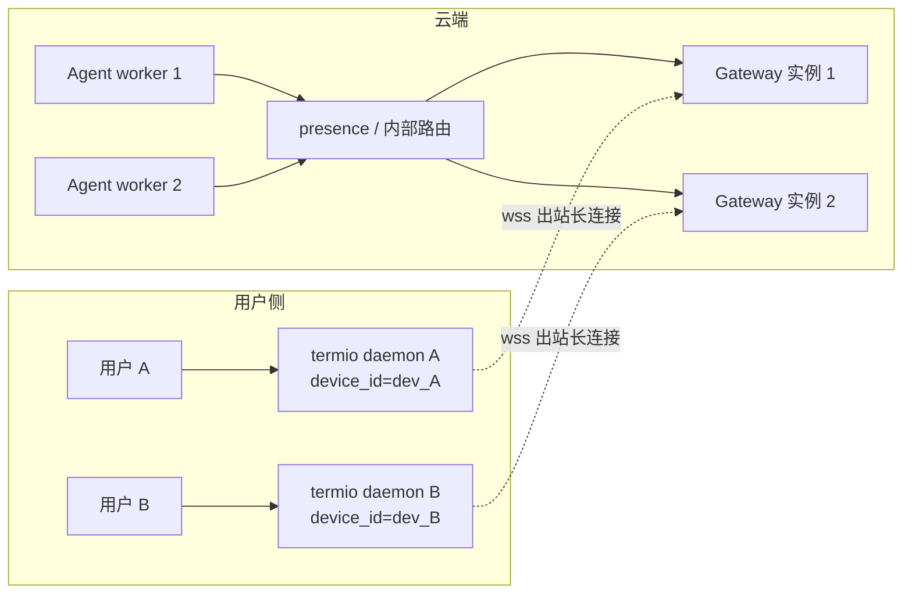

# 架构

## 目标

云端 Agent 作为基础服务，同时服务多个租户；租户的真实工作环境在各自的电脑上。Agent 决定调用哪个工具，但工具必须在该租户的机器上执行。Termio 提供这一层**地端工具执行通道**：

- 云端不接触租户文件系统，只负责决策、路由和审计。
- 地端只暴露**已注册的只读工具**，不是一台可远程登录的机器。
- 地端主动外连，不需要公网 IP、端口映射或入站防火墙规则。
- 一个二进制覆盖 Windows / macOS / Linux。

v1 的目标是把这条链路做稳：注册、调用、进度、取消、超时、重连、幂等、沙箱。配对、多实例网关、写操作等留给后续版本。

## 组件

```
┌──────────────────────────── 云端 ────────────────────────────┐
│  Cloud Agent (多租户)                                          │
│    └─ tool stub ── HTTP ──▶ termio-gateway                    │
│                              ├─ 设备鉴权 / 路由 / pending call │
│                              └─ 持有地端 WebSocket 会话        │
└───────────────────────────────────┬───────────────────────────┘
                                    │ 出站长连接（wss）
┌───────────────────────────────────▼───────────────────────────┐
│  地端 termio daemon                                            │
│    ├─ 配置 / 日志 / 自启动                                     │
│    ├─ 工作区注册表（WorkspaceSet）                             │
│    │    ├─ Workspace A: os.Root + 工具注册表 + 并发信号量      │
│    │    └─ Workspace B: os.Root + 工具注册表 + 并发信号量      │
│    └─ 调度器：工作区/会话路由、超时、取消、进度、幂等缓存       │
└────────────────────────────────────────────────────────────────┘
```

### `termio`（地端）

- 读取配置，为每个已注册工作区打开独立 `os.Root` 沙箱和工具注册表。
- `$LARES` 是 app home，默认 `~/.lares`；端子信息（config、token、日志）在 `$LARES/.termio`，该目录对**所有**工作区 deny，工具不可读写。
- 工作区：默认 `$LARES`；用户可注册多个本地目录；每次调用按 `workspaceId` 选择工作区，省略时用默认工作区。一个工作区可服务多个会话/任务。详见 [workspace.md](workspace.md)。
- 主动连接 `gateway_url`，发送 `termio/register`，上报设备信息、工具列表和工作区 ID/名称（不报路径）。
- 维护心跳；断线后指数退避重连。
- 收到 `tools/call` 后交给调度器；每个调用独立 goroutine，读循环不被阻塞。
- 执行工具，发送 progress 和最终结果；支持 `notifications/cancelled`。
- 以用户级自启动运行，保证能读到当前用户的文件。

### `termio-gateway`（参考网关）

- 在 WebSocket 升级前完成设备鉴权。
- 维护 `device_id → session` 的内存 hub；同一设备重连时 last-wins，旧连接用 4003 关闭。
- 提供 HTTP API 给云端 Agent；每个 HTTP 调用分配网关侧 JSON-RPC id，并转发 `termio/callId`。
- 断线时让所有 pending 调用失败，不留下悬挂请求。
- 单实例、内存态、无持久化；生产实现见“扩展到多实例”。

## 连接生命周期

1. 地端带 `Authorization: Bearer <token>` 和 `X-Termio-Device: <device_id>` 发起 WebSocket。
2. 网关在升级前鉴权；失败返回 HTTP 401，不建立连接。
3. 地端在 10 秒内发送首帧 `termio/register`，包含协议版本、设备信息和工具列表。
4. 网关校验设备 ID、协议版本，返回 session id、心跳间隔和调用超时。
5. 网关把会话放入 hub；之后云端 HTTP 调用通过该会话下发。
6. 双方每 20 秒 ping/pong；任一侧发现失败就关闭连接。
7. 地端按 1s → 30s 指数退避重连；收到 4003（被新连接取代）时冷却 5 分钟，避免重连风暴。

## 一次工具调用

```
Cloud Agent          Gateway                    Daemon
    │ POST /tools/call │                          │
    ├─────────────────▶│                          │
    │                  ├─ tools/call (WS) ───────▶│
    │                  │                          ├─ sandbox + tool
    │                  │◀──── progress (WS) ──────┤
    │                  │◀──── result (WS) ────────┤
    │◀── HTTP result ──┤                          │
```

- 云端 HTTP 请求是同步的；工具执行时间受 `timeout_ms` / 配置约束。
- 进度通知 v1 只在网关日志中可见，不通过 HTTP 流式返回；最终结果同步返回。
- 云端断开时，网关向地端发送 cancel；地端取消 context。

## 工作区与会话路由

```
Cloud 会话/任务 ── workspace_id + session_id ──▶ Gateway ──▶ Daemon
                                                              │
                                    ┌─────────────────────────┴──────────────┐
                                    ▼                                        ▼
                            Workspace A (ws_a)                       Workspace B (ws_b)
                            os.Root A + Registry A                   os.Root B + Registry B
                            Semaphore A                              Semaphore B
                                    ▲                                        ▲
                              会话 1、会话 2                            会话 3
```

- **工作区 1:N 会话**：同一工作区的多个云端会话共享目录和沙箱；会话只是调用上下文，不是隔离副本。
- **每次调用固定一个工作区**：daemon 在收到 `tools/call` 时解析 `_meta["termio/workspaceId"]`（空则默认），之后整个调用只使用该 `Workspace` 的 sandbox/registry。
- **工作区之间并发**：每个工作区有自己的信号量；A 的长任务不会占满 B 的额度。
- **热切换**：已注册工作区之间的切换只是换一个 ID，不需要重连或重启。
- **增删工作区**：daemon 启动时打开所有沙箱，网关也在注册时缓存列表，因此 v1 新增/删除工作区需要重启 daemon；重启会取消在途调用。
- **幂等域**：`(workspaceId, sessionId, callId)`；同一 callId 跨工作区/会话互不影响。
- **可观测性**：结果、progress、cancel 的 `_meta` 都带工作区和会话，日志也按这两个维度记录。

## 多租户模型

Termio 的隔离主要发生在三个位置：

1. **网关路由**：设备用 `device_id` 标识；每个设备有独立 token。按设备 token 鉴权时，调用方只能访问自己那台设备。`--token` 共享令牌只为开发方便，不应作为多租户生产配置。
2. **地端沙箱**：每台设备为每个已注册工作区打开独立沙箱；一次调用只能进入其中一个工作区，工具无法访问该工作区及其额外根之外的路径。工作区由本地用户注册，云端只能选择 ID，不能新增路径，见 [workspace.md](workspace.md)。
   - `session_id` 不是安全边界：同设备的不同会话共享设备 token 的权限；不要用它表达跨租户隔离。
3. **工具白名单**：地端只注册只读工具，且没有 shell/写操作；云端无法通过 Termio 执行任意命令。

v1 的参考网关用静态 `--devices-file` 保存 `device_id → token`。生产环境应替换为：

- 设备配对/绑定流程（一次性配对码、设备码、OAuth device flow 等）
- token 生命周期（轮换、吊销、哈希存储）
- 租户/设备数据库与审计
- 速率限制、并发配额、异常检测
- 网关多实例 + presence

这些替换不需要改地端协议。

## 部署拓扑：一个用户一个端子，一个云端 Agent 服务

先把三个角色分开，避免把“云 Agent 只有一个”理解成“只有一个进程”：

| 角色 | 职责 | 是否有状态 |
|---|---|---|
| **Cloud Agent** | 决策、调用工具、编排任务 | 无状态 worker，可水平扩展 |
| **Gateway** | 持有地端 WebSocket、路由、pending call、鉴权 | 有状态：连接在哪个实例，状态就在哪 |
| **Daemon** | 在用户机器上执行工具、沙箱、自启动 | 每用户/设备一个长驻进程 |

一个用户对应一台机器/一个端子，这是合理的产品假设；协议用 `device_id` 标识设备，因此一个用户未来有多台机器时，只是多一个 device_id。一个逻辑上的云 Agent 可以是很多个无状态 worker；每个 worker 通过 HTTP 调 Gateway，不需要自己持有所有地端连接。



上图是 **V2 的目标拓扑**。V1 只有一个 Gateway 实例：所有 Agent worker（或单个 Agent 进程）都调它，地端都连它。这足够验证链路，但它是单点和容量上限。

关键点：

- **Cloud Agent 不要自己持有所有 WebSocket**。连接是状态，Agent worker 应尽量无状态；否则每次扩缩容都会丢连接。
- **Gateway 才是连接面**。它可以和 Agent 同进程部署（小规模），也可以独立部署（推荐生产）。
- **一个用户一个端子**：daemon 只连接到 Gateway，不需要知道是哪个 Agent worker 发起的调用。
- **多实例路由**需要 presence（device_id → gateway 实例）+ 内部总线，见下一节；V1 不实现。

## 扩展到多实例网关

单实例网关是有状态的：WebSocket 连接只存在于持有它的进程里；云端 worker 是无状态的。要水平扩展，需要先定位设备连接在哪个网关实例：

1. **presence**：`device_id → gateway_instance_id`，带 TTL 租约。
2. **内部总线**：worker 通过 NATS 发布到实例寻址的 subject，例如
   `termio.node.<instance_id>.rpc.<device_id>`；网关订阅自己的 node subject，进度和结果通过 reply inbox 返回。
3. 网关重启或连接迁移时，更新 presence；设备重连后重新注册。

JSON-RPC 负载保持不变，地端无需修改。另一种更简单的方案是每个网关只订阅自己已连接设备的 subject，但订阅数量会随设备数增长。

v1 不实现这些，只把 `internal/gateway` 的 hub 作为单实例默认实现。

## 连接数与容量：K 个用户会怎样

**先回答结论**：是的，每个端子启动后会向 Gateway 建立一条长连接；K 个用户就是 K 条连接。这不是异常，而是这类系统（IM、在线状态、IoT、远程协作）的常见模型。问题不在“有没有 K 条连接”，而在**连接放在哪一层、单机能撑多少、怎么水平扩展**。

### 连接应该放在 Gateway，而不是 Agent worker

- Cloud Agent worker 是决策层：它的数量随请求量扩缩，**不应该持有 K 条地端连接**。
- Gateway 是连接层：它持有 WebSocket、维护 `device_id → session`，按调用路由。
- 这样 Agent 扩缩容不会断开用户连接；连接数增长只需要扩 Gateway。

如果 v1 把 Agent 和 Gateway 放在同一个进程里（小规模可以），那个进程就要承担 K 条连接；生产环境应拆开。

### 单条空闲连接的成本

粗略量级（必须用真实压测校准，不要当成 SLA）：

| 成本项 | 量级 |
|---|---|
| 用户态 | goroutine 栈、`coder/websocket` 读写缓冲、pending map、TLS 状态（若由 Go 终止）：几十 KB |
| 内核 | socket 收发缓冲：几十 KB，可通过 sysctl 调整 |
| 代理 | 如果 Caddy/Nginx 终止 TLS，代理和 Gateway 各持有一份连接状态，按两层计算 |
| 心跳 | 每 20s 一次 ping/pong；K=10k 时约 500 帧/s，CPU 很低 |
| 活跃调用 | 只有正在执行的调用才有额外 goroutine/pending 记录；搜索等重活在用户机器上，云端只传小 JSON |

粗略公式：

```
总连接开销 ≈ K × (用户态 + 内核缓冲 + TLS/代理) + 活跃调用开销
```

数量级参考（**不是本仓库的实测结果**）：

| K（在线端子） | 建议 |
|---|---|
| < 1,000 | 单 Gateway 实例通常足够 |
| 1,000–10,000 | 单实例可能可以，但建议至少 2 实例做 HA；调 FD/内核参数并压测 |
| 10,000–100,000 | 多 Gateway 实例 + presence/NATS 路由 + 连接准入/限流；必须压测 |
| > 100,000 | 专用连接层/多区域；评估 MQTT 5 或边缘 relay |

单机真正的瓶颈通常不是内存，而是：

- 文件描述符上限：`ulimit -n`、`fs.file-max`
- TCP backlog：`net.core.somaxconn`、`net.ipv4.tcp_max_syn_backlog`
- 反向代理的 `worker_connections`
- TLS 握手 CPU（尤其在重启/重连风暴时）
- 重连风暴：我们的退避是 1s→30s ±20%；K 很大时，Gateway 重启会让大量客户端在 1 秒附近同时重连。V2 需要连接准入、随机初始延迟、限流和分批恢复。

### 为什么工具调用本身不会放大连接数

- 一次调用只路由到**一台**设备，不是广播。
- Gateway 的路由是 `device_id → session` 的 O(1) 查找。
- 搜索/读取在用户机器上执行；云端只转发小的请求/结果帧。
- 每个设备默认最多 4 个并发调用；云端不会因为 K 大就产生 K 倍的 LLM 调用。

### 什么时候该考虑 MQTT

如果 K 达到百万级、设备是低功耗/弱网/经常离线，MQTT broker 在连接数、QoS、持久会话上更成熟，值得评估。但它仍然需要解决工具请求-响应、取消、进度和 schema；对“用户电脑 + 交互式工具调用”这个场景，WebSocket 更直接。当前选择是 WS，不排除未来为极端规模增加 MQTT 边缘层。

### 压测建议

不要凭感觉选容量。用一个 Go 压测客户端模拟 K 个假端子：

1. 建立 K 条 WS，发送注册帧，保持心跳。
2. 测量 Gateway RSS、FD 数、CPU、p99 心跳延迟。
3. 以低 QPS 触发 `system_info`，测 p50/p99 调用延迟。
4. 杀掉/重启 Gateway，观察 K 个客户端的重连曲线和失败率。
5. 分别在直连和经过 Caddy/Nginx 两种拓扑下测。
6. 再测“少数设备高频调用”和“多数设备空闲”两种分布。

v1 的参考网关是单实例内存实现，适合开发和中小规模试点；大规模 K 需要 V2 的分布式 Gateway，见 [roadmap.md](roadmap.md)。

## 可靠性语义

- **at-least-once + 去重窗口**：不是 exactly-once。地端按 `termio/callId` 缓存最终结果 10 分钟（最多 1024 条）；重试同一 callId 会重放。
- **离线**：设备不在线时网关立即返回 `-32011`，不排队。设备恢复后，云端用相同 callId 重试；只有 10 分钟内的已完成结果会被重放。
- **断线**：网关让 pending 调用立即失败；地端取消执行中的调用。云端应把网络错误视为可重试。
- **超时**：地端在截止时间返回 `isError` 结果；网关最多再等 2 秒，然后发 cancel 并返回 504。
- **重复连接**：同一 device_id 的新连接会关闭旧连接（4003）；旧进程冷却 5 分钟。
- **缓存丢失**：地端重启会丢失幂等缓存；这不是持久化队列。

## 关键取舍

| 决策 | 原因 |
|---|---|
| 反向 WebSocket，而不是 MQ | 出站穿透 NAT；原生双向、多路复用、支持进度/取消；无需运维 broker |
| MQTT 5 作为备选 | 弱网/离线/海量设备更合适；但请求响应、取消、流式进度需要额外设计 |
| 复用 MCP 方法/结果形状 | 云端工具接入成本低；不绑定完整 MCP 传输，避免被 Streamable HTTP 限制 |
| JSON-RPC id 逐跳 + `_meta.callId` 端到端 | 重连/重试需要稳定幂等键，不能让 JSON-RPC id 跨跳复用 |
| 相对超时 | 避免云端/地端时钟偏差 |
| `os.Root` 沙箱 | 在真正打开文件时阻止符号链接/junction 逃逸，而不是只做字符串前缀检查 |
| 用户级自启动 | Windows LocalSystem/root 读不到当前用户文件；用户级才符合场景 |
| 只读工具 v1 | 把攻击面降到最低；写操作需要审批/能力模型，不能直接加 |
| 单依赖 `coder/websocket` | 分发小、无 CGO、三端交叉编译简单 |

## 未来 UI / 托盘（v1 不做）

v1 是纯后台服务，没有桌面 UI/托盘。这不是技术限制，而是范围取舍：先验证“云端决策 → 地端执行”的链路。

如果后续要做托盘/设置界面，选型建议：

| 方案 | 适合 | 代价 |
|---|---|---|
| **Tauri** | 想要小体积、强安全边界，团队接受 Rust + Web UI | 引入 Rust 工具链；三端打包/签名更复杂 |
| **Wails** | 团队希望保持 Go 为主，UI 用 Web 技术 | WebView 运行时依赖；生态比 Tauri 小 |
| **Electron** | 优先开发速度/生态，能接受体积和内存 | 包体大、内存高，和“轻量常驻端子”气质不符 |

无论选哪个，原则不变：

- UI 是**本地控制面**的客户端，不是第二个云端入口。通过 Unix socket / Windows named pipe（或仅回环 + 本地鉴权）访问 daemon；不要暴露到公网。
- UI 负责配对、allowed roots、暂停/恢复、日志查看、危险操作审批；核心 WebSocket 协议和云端接入不变。
- UI 不能绕过沙箱或工具策略；所有执行仍然走 daemon 的工具注册表。
- 配对/审批如果未来要做，UI 只是交互层，真正的授权判断必须在地端 daemon 内完成。

## 非目标（v1）

- 完整 MCP Server（resources/prompts/sampling/Streamable HTTP）
- 写文件、删除、shell/PTY、进程管理
- 文件内容 grep/正则搜索
- 离线任务队列、持久化幂等日志
- 多实例网关、presence、NATS
- GUI/托盘（选型见“未来 UI / 托盘”）、自动更新、代码签名/notarization
- 配置热加载、指标/追踪
