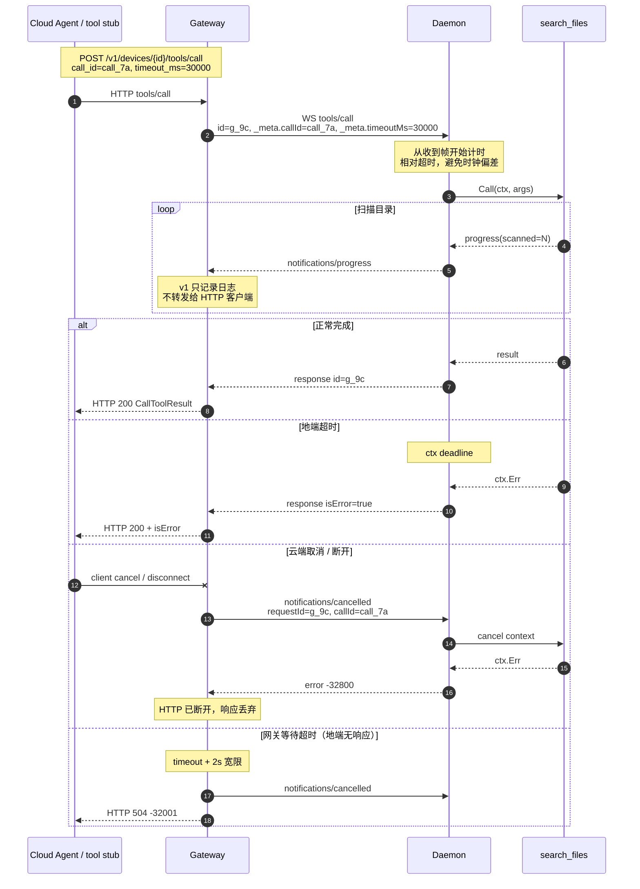
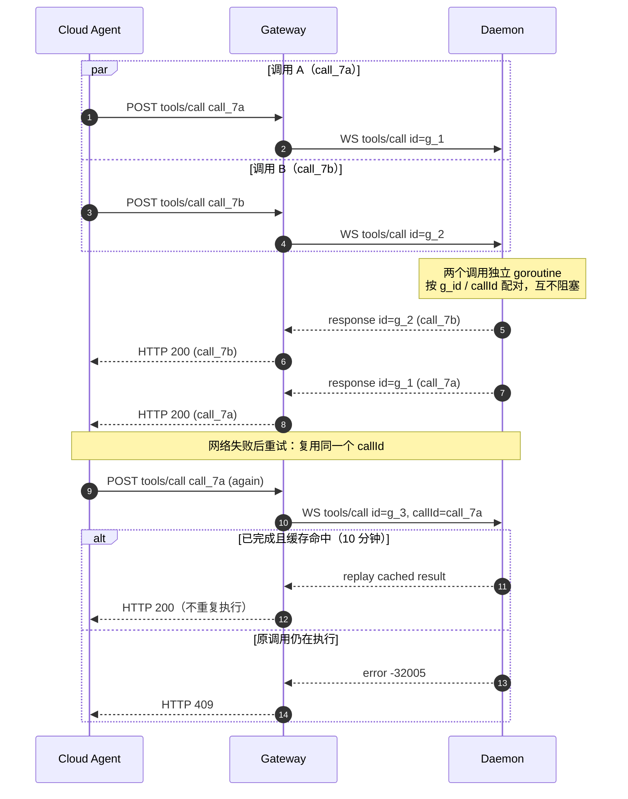

# 协议

Termio 的线协议是 **JSON-RPC 2.0 + MCP 工具语义**，运行在一条由地端主动建立的 WebSocket 上。它复用 MCP 的方法名和工具结果形状，但**不是** MCP 的 Streamable HTTP 传输，也不实现完整的 MCP Server。

## 传输规则

- 每个 WebSocket **文本帧**承载一个 JSON-RPC 对象；不支持批量数组。
- 单帧最大 4 MiB；不支持二进制帧。
- 所有消息可以并发乱序完成；用 JSON-RPC `id` 关联。
- WebSocket 控制帧 Ping/Pong 用于存活检测，不使用 JSON-RPC ping。
- 网关每 20 秒 ping；10 秒无 pong 视为断线。地端也会主动 ping。

## 鉴权与连接头

地端连接 `GET {gateway_url}`，带：

```http
Authorization: Bearer <device-token>
X-Termio-Device: <device_id>
User-Agent: termio/<version> (<os>/<arch>)
```

网关在 WebSocket 升级**之前**完成鉴权，失败返回 HTTP 401。升级后的首帧必须是 10 秒内的 `termio/register`，否则用 4004 关闭。

HTTP API 使用同样的 Bearer token。

## 方法

| 方向 | 方法 | 说明 |
|---|---|---|
| 地端 → 网关 | `termio/register` | 首帧：协议版本、设备信息、工具列表、工作区列表 |
| 网关 → 地端 | `tools/list` | 返回当前工具定义 |
| 网关 → 地端 | `tools/call` | 执行工具 |
| 地端 → 网关 | `notifications/progress` | 执行进度（best effort） |
| 网关 → 地端 | `notifications/cancelled` | 取消调用 |
| 双向 | WebSocket Ping/Pong | 存活检测 |

## 注册

请求：

```json
{
  "jsonrpc": "2.0",
  "id": "reg_4f2a...",
  "method": "termio/register",
  "params": {
    "protocol_version": 1,
    "mcp_version": "2025-06-18",
    "device": {
      "id": "dev_0e59845886b548db6f5dcaf4df7d818a",
      "name": "my-laptop",
      "os": "windows",
      "arch": "amd64",
      "version": "0.1.0"
    },
    "tools": [
      {
        "name": "system_info",
        "description": "Return OS, architecture, hostname, version, and allowed roots.",
        "inputSchema": {"type": "object", "properties": {}, "additionalProperties": false}
      }
    ],
    "workspaces": [
      {"id": "ws_default", "name": "default"},
      {"id": "ws_docs", "name": "docs"}
    ],
    "default_workspace_id": "ws_default",
    "max_inflight": 4
  }
}
```

- `workspaces` 只报告 `id` 和展示名；本地路径永远不上报。
- `default_workspace_id` 省略时网关取列表第一项；有工作区列表但默认值不在列表中时注册失败。
- 工作区 ID 必须唯一，最多 64 个；旧地端可以不发送这两个字段，此时所有调用落到地端的本地默认工作区。

响应：

```json
{
  "jsonrpc": "2.0",
  "id": "reg_4f2a...",
  "result": {
    "protocol_version": 1,
    "mcp_version": "2025-06-18",
    "session_id": "sess_...",
    "server_time": "2026-10-22T12:00:00Z",
    "heartbeat_interval_ms": 20000,
    "call_timeout_ms": 30000,
    "max_inflight": 4
  }
}
```

- `protocol_version` 必须精确匹配 1，否则网关用 4002 关闭。
- `device.id` 必须与鉴权绑定的设备一致，否则用 4001 关闭。
- `mcp_version` 是信息性的，记录结果形状所遵循的 MCP 版本。
- 同一 device_id 的新连接会取代旧连接；旧连接收到 4003。

## 工具发现

```json
{"jsonrpc":"2.0","id":"g_1","method":"tools/list","params":{}}
```

```json
{"jsonrpc":"2.0","id":"g_1","result":{"tools":[
  {"name":"read_file","description":"...","inputSchema":{...}}
]}}
```

网关在注册时已经缓存了工具列表；`tools/list` 用于动态刷新。

## 调用

请求：

```json
{
  "jsonrpc": "2.0",
  "id": "g_9c1f...",
  "method": "tools/call",
  "params": {
    "name": "search_files",
    "arguments": {"pattern": "*.go", "max_results": 20},
    "_meta": {
      "progressToken": "optional-cloud-token",
      "termio/callId": "call_7a3c...",
      "termio/workspaceId": "ws_docs",
      "termio/sessionId": "chat-42",
      "termio/timeoutMs": 30000
    }
  }
}
```

- JSON-RPC `id` 是**逐跳**的，由网关生成，只用于这条连接上的请求/响应配对。
- `_meta["termio/callId"]` 是**端到端幂等键**，跨重连和 HTTP 重试保持不变。
- `_meta["termio/workspaceId"]` 选择本地已注册的工作区；省略时使用默认工作区。未知 ID 返回 `-32012`。
- `_meta["termio/sessionId"]` 标识云端会话/任务；一个工作区可以同时服务多个会话。它只是上下文标签，不参与鉴权。
- `_meta["termio/timeoutMs"]` 是相对毫秒数；地端会把它限制在 1 秒到 5 分钟之间，并与自身配置的 `call_timeout_ms` 取较小值。
- `progressToken` 可省略；进度通知会原样回传。

成功结果：

```json
{
  "jsonrpc": "2.0",
  "id": "g_9c1f...",
  "result": {
    "content": [{"type": "text", "text": "Found 2 matching file(s) ..."}],
    "structuredContent": {"matches": [], "truncated": false},
    "isError": false,
    "_meta": {
      "termio/callId": "call_7a3c...",
      "termio/workspaceId": "ws_docs",
      "termio/sessionId": "chat-42"
    }
  }
}
```

工具执行失败（路径越界、权限不足、工具内部错误、地端超时）使用 **HTTP 200 风格的 `isError: true` 结果**，而不是 JSON-RPC 错误：

```json
{
  "jsonrpc": "2.0",
  "id": "g_9c1f...",
  "result": {
    "content": [{"type": "text", "text": "path is outside the allowed roots"}],
    "isError": true,
    "_meta": {"termio/callId": "call_7a3c..."}
  }
}
```

协议级错误（参数错误、未知工具、取消、过载等）才使用 JSON-RPC `error`。

## 进度

```json
{
  "jsonrpc": "2.0",
  "method": "notifications/progress",
  "params": {
    "progressToken": "optional-cloud-token",
    "progress": 512,
    "total": 0,
    "message": "scanned 512 entries",
    "_meta": {
      "termio/callId": "call_7a3c...",
      "termio/workspaceId": "ws_docs",
      "termio/sessionId": "chat-42"
    }
  }
}
```

- 尽力而为：地端每 250ms 最多发一次；写失败会丢弃，不影响工具执行。
- `progress` 单调不减；`total` 可能为 0（未知）。
- 进度**不会完成调用**；只有带匹配 `id` 的最终响应才会。
- v1 网关只把进度写 debug 日志，不通过 HTTP 流式返回。

## 取消

```json
{
  "jsonrpc": "2.0",
  "method": "notifications/cancelled",
  "params": {
    "requestId": "g_9c1f...",
    "reason": "client_cancelled",
    "_meta": {
      "termio/callId": "call_7a3c...",
      "termio/workspaceId": "ws_docs",
      "termio/sessionId": "chat-42"
    }
  }
}
```

- `requestId` 是网关侧的 JSON-RPC id；地端优先用它定位正在执行的调用。
- 没有 `requestId` 时，地端用 `(workspaceId, sessionId, callId)` 组合定位；省略 `workspaceId` 时使用默认工作区。
- 地端取消 context，并返回错误码 `-32800`。
- 幂等：调用已完成、已取消或不存在时忽略。
- 云端 HTTP 客户端断开、或网关等待超时时，网关会自动发送取消。

## 幂等与重试

- 地端按 `(workspaceId, sessionId, callId)` 缓存最终结果 10 分钟，最多 1024 条。
- 相同键 + 相同工具/参数：已完成则重放；执行中返回 `-32005`。
- 相同键 + 不同工具/参数：返回 `-32602`。
- 同一个 `callId` 在不同工作区或不同会话中是独立调用，不会互相重放。
- 缓存是内存态，地端重启后丢失。
- 语义是 **at-least-once + 去重窗口**，不是 exactly-once。
- 取消、终止、内部错误不缓存；工具超时会作为 `isError` 结果缓存。

## 时序：一次 search_files

下面的图覆盖请求/响应配对、进度、相对超时、取消、多路复用和幂等重试。`30s`/`15s` 只是示例。

### 单次调用与取消



说明：

- **配对**：网关用 JSON-RPC `id`（如 `g_9c`）配对地端响应；`callId` 只用于端到端幂等和跨重试追踪。
- **进度**：地端每 250ms 最多发一次；v1 网关只写 debug 日志，不把 progress 流式转给 HTTP 客户端。
- **相对超时**：`_meta.timeoutMs` 从地端收到帧开始计时，不依赖两台机器的绝对时钟。
- **取消来源**：v1 的“用户取消”等价于云端 HTTP 客户端取消/断开；地端没有本地 UI。未来本地 UI 可以通过本地控制面取消，协议不变。
- **网关超时**：网关最多等 `timeout + 2s`，让地端自己的超时结果先返回；地端无响应时发 cancel 并返回 504。

### 多路复用与幂等重试



- 一条 WebSocket 同时承载多个调用；响应可以乱序返回，HTTP 调用方各自等待自己的结果。
- 重试必须复用 `callId`，但网关会为新的请求生成新的 JSON-RPC `id`。
- 已完成的结果直接重放；执行中的重复请求返回 `-32005`，不会并行执行第二次。

## 错误码

| 码 | 含义 | 网关 HTTP 映射 |
|---|---|---|
| `-32602` | 参数错误 / 未知工具 / callId 冲突 | 400 |
| `-32603` | 内部错误 | 502 |
| `-32800` | 请求已取消 | 409 |
| `-32001` | 网关侧超时 | 504 |
| `-32005` | 同一 callId 正在执行 | 409 |
| `-32010` | 地端并发已满 | 429 |
| `-32011` | 设备不在线 / 连接断开 | 404 / 502 |
| `-32012` | 工作区不存在 | 400 |
| `-32020` | 协议版本不支持 | 502（注册阶段直接关闭） |

## WebSocket 关闭码

| 码 | 含义 |
|---|---|
| `4001` | 设备 ID 不匹配鉴权绑定 |
| `4002` | 协议版本不支持 |
| `4003` | 被同一设备的新连接取代；地端冷却 5 分钟再重连 |
| `4004` | 注册超时 |
| `4005` | 网关过载（保留） |

## HTTP API

### `GET /healthz`

无需鉴权。

```json
{"status":"ok","version":"0.1.0","devices":1}
```

### `GET /v1/devices`

需要 Bearer token。共享 token 返回全部设备；按设备 token 只返回匹配的设备。

```json
{
  "devices": [
    {
      "id": "dev_...",
      "name": "my-laptop",
      "os": "windows",
      "arch": "amd64",
      "version": "0.1.0",
      "connected_at": "2026-10-22T12:00:00Z",
      "tools": [{"name": "search_files", "description": "...", "inputSchema": {}}],
      "workspaces": [
        {"id": "ws_default", "name": "default"},
        {"id": "ws_docs", "name": "docs"}
      ],
      "default_workspace_id": "ws_default",
      "max_inflight": 4
    }
  ]
}
```

`workspaces` 只含 ID/名称，不含本地路径。

### `GET /v1/devices/{id}/tools`

返回该设备的工具列表和注册的 `max_inflight`。设备不在线返回 404。

- 默认返回注册时缓存的列表。
- `?refresh=1`（或 `?refresh=true`）会让网关向地端发送 `tools/list`，用最新结果刷新缓存后返回；这也会实际走到 daemon 的 `tools/list` 处理路径。

### `GET /v1/devices/{id}/workspaces`

返回该设备已注册的工作区元数据和默认工作区。设备不在线返回 404。

```json
{
  "device_id": "dev_...",
  "workspaces": [
    {"id": "ws_default", "name": "default"},
    {"id": "ws_docs", "name": "docs"}
  ],
  "default_workspace_id": "ws_default"
}
```

### `POST /v1/devices/{id}/tools/call`

请求体：

```json
{
  "name": "search_files",
  "arguments": {"pattern": "*.go"},
  "timeout_ms": 30000,
  "call_id": "optional-stable-id",
  "progress_token": "optional-cloud-token",
  "workspace_id": "ws_docs",
  "session_id": "chat-42"
}
```

- `name` 必填；`arguments` 省略时视为 `{}`。
- `call_id` 省略时网关生成 `call_<hex>`；重试时应复用。
- `workspace_id` 省略时网关填入设备的默认工作区 ID；网关按注册列表校验，未知 ID 返回 HTTP 400 + `-32012`，不会转发给地端（旧地端未上报工作区时也会被拒绝，避免静默落到其唯一工作区）。
- `session_id` 可选，最多 256 个可打印字符；用于云端关联会话，不参与鉴权。
- `timeout_ms` 会与网关配置的 `call_timeout` 取较小值，并限制在 1 秒到 5 分钟。
- 请求体上限 1 MiB。

成功时直接返回 MCP `CallToolResult`（不包 JSON-RPC envelope）；工具失败仍是 HTTP 200 + `isError: true`。协议错误返回：

```json
{"error":{"code":-32602,"message":"unknown tool \"nope\""}}
```

HTTP 状态映射见错误码表。网关等待 `timeout + 2s`，让地端自己的超时结果先返回。

## 限制

| 项 | 值 |
|---|---|
| WebSocket 单帧 | 4 MiB |
| HTTP 请求体 | 1 MiB |
| `read_file` 返回 | 512 KiB |
| `search_files` 结果 | 1000 条 |
| 搜索 pattern | 256 字节 |
| 请求路径 | 4096 字节 |
| 每工作区并发 | 配置 1–32，默认 4（工作区之间独立） |
| 调用超时 | 1s–5min，默认 30s |
| 幂等缓存 | 10 分钟 / 1024 条 |
| 进度频率 | 每调用最多 4 次/秒 |

## 与 MCP 的关系

复用的部分：

- `tools/list` / `tools/call` 方法名
- `inputSchema`、`content`、`structuredContent`、`isError`
- `notifications/progress`、`notifications/cancelled` 的形状
- `_meta` 作为扩展点

不复用的部分：

- Streamable HTTP 传输
- `initialize`、resources、prompts、sampling、completions
- 完整的 MCP 会话协商

这样云端可以很容易把地端工具包装成 Agent 框架的工具，同时保留反向 WebSocket 带来的 NAT 穿透和双向能力。
