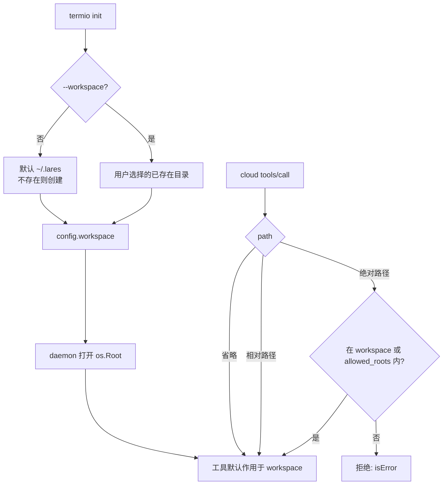

# 工作区（Workspace）

> **状态：V1 已实现。**
>
> 配置字段 `workspace`、`termio workspace show/set/reset`、工具默认路径/相对路径、`system_info.workspace` 均已落地。当前 `allowed_roots` 仅作为额外根。
>
> 本文用 **`$LARES`** 表示端子的 app home：默认 `~/.lares`（Windows `%USERPROFILE%\.lares`），可用 `TERMIO_HOME` / `LARES_HOME` 覆盖。端子信息（config、log）放在 `$LARES/.termio`。

## 1. 概念

**工作区**是用户本机上的一个目录，也是端子默认的“工作范围”。

- **`$LARES`**：端子的 app home，默认 `~/.lares`。
- **默认工作区**：`$LARES`。
- **端子信息**：`$LARES/.termio`（config.json、termio.log 等），永远不对工具开放。
- 用户可以在本地选择一个已存在的目录作为工作区；之后工具的默认路径、相对路径和默认搜索范围都在该工作区下。
- 一个端子同一时间只有一个活动工作区。
- 工作区只由**本地用户**选择；云端 Agent 不能通过 `tools/call` 更改。
- 工作区仍然受 `os.Root` 沙箱约束，不是“任意路径通行证”。

可以把工作区理解为：**用户授权给 Agent 的默认目录**。选择工作区 = 授权 Agent 读写该目录（v1 工具只读）。

## 2. 默认路径

| 系统 | `$LARES`（默认工作区） | 端子信息 |
|---|---|---|
| Windows | `%USERPROFILE%\.lares` | `%USERPROFILE%\.lares\.termio` |
| macOS | `~/.lares` | `~/.lares/.termio` |
| Linux | `~/.lares` | `~/.lares/.termio` |

规则：

- `termio init` 未指定工作区时，使用 `$LARES`。
- 默认 `$LARES` 不存在时，`init` 创建它（Unix 0700；Windows 使用用户目录 ACL）。
- 显式 `--workspace PATH` 时，`PATH` **必须已存在且是目录**，避免拼写错误创建任意目录。
- 如果取不到用户 home 且没有显式指定工作区，`init` 报错并提示使用 `--workspace`。
- `TERMIO_HOME` 或 `LARES_HOME` 可以覆盖 `$LARES`；端子信息始终在 `$LARES/.termio`。
- 工作区路径会做绝对化和符号链接规范化（`EvalSymlinks`），再交给 `os.Root`。

## 3. 与 allowed_roots 的关系

引入工作区后，两个概念要明确：

| 概念 | 作用 |
|---|---|
| `workspace` | **当前**默认/主要工作目录；工具省略 `path` 或使用相对路径时的基准 |
| `allowed_roots` | **额外**的允许目录（高级用法）；不要放 workspace 的副本 |

有效沙箱根：

```
effective_roots = dedupe([workspace] + allowed_roots)
```

规则：

- 新 `init`：`workspace = ~/.lares`，`allowed_roots = []`（除非用 `--root` 指定额外根）。
- 旧配置没有 `workspace`：如果 `allowed_roots` 非空，取**第一个**作为工作区，其余作为额外根（迁移后有效根不变）。
- `workspace` 始终进入有效根；`allowed_roots` 只表示额外根。
- `workspace set` 只替换当前工作区：旧工作区默认**不再可访问**，除非它被显式列在 `allowed_roots` 里。这与“用户选择工作区后就在该工作区下工作”的语义一致。
- `system_info` 返回 `workspace` 和**有效根**（为了兼容现有字段，仍然叫 `allowed_roots`；可以额外返回 `extra_roots` 表示配置里的额外根）。
- `--root` 仍然是“额外根”的意思；不要把它和工作区混为一谈。

## 4. 配置

```json
{
  "workspace": "C:\\Users\\alice\\.lares",
  "gateway_url": "wss://gateway.example.com/ws",
  "device_id": "dev_...",
  "device_name": "alice-laptop",
  "token": "...",
  "allowed_roots": [],
  "max_concurrent_calls": 4,
  "call_timeout_ms": 30000,
  "log_level": "info",
  "log_file": "C:\\Users\\alice\\.lares\\.termio\\termio.log"
}
```

校验：

- `workspace` 必须是绝对路径、存在、是目录。
- 规范化后加入有效根；重复项去重。
- 工作区不可读时，启动失败或由 `doctor` 明确报错，**不要静默回退**到 home 或 `.lares`，否则会悄悄改变授权范围。

## 5. CLI 设计

### 初始化

```bash
# 默认 ~/.lares
termio init --token <token>

# 本地选择一个已存在的目录
termio init --token <token> --workspace /home/alice/projects/acme

# 额外根（高级）
termio init --token <token> --workspace /home/alice/.lares --root /home/alice/shared
```

兼容规则：

- 只给 `--root`、没给 `--workspace` 时，把第一个 `--root` 当作工作区，其余作为额外根；这样已有的 `termio init --root "$PWD"` 脚本不会被改变意图。
- 同时给 `--workspace` 和 `--root` 时，`workspace + extra roots`。
- 都不给：`~/.lares`。

### 查看/切换

```bash
termio workspace show
termio workspace set /home/alice/projects/acme
termio workspace reset          # 回到默认 ~/.lares
```

- `show` 输出：当前路径、来源（默认/用户选择）、是否存在、是否可读、是否在有效根中。
- `set` 只允许本地用户操作；校验目录存在；写入配置。旧工作区默认不再可访问，除非它被显式保留在 `allowed_roots` 里。
- `reset` 回到 `~/.lares`；同样替换当前工作区，额外根保持不变。
- v1 没有配置热加载：切换后提示需要重启端子；重启时取消在途调用，新调用使用新工作区。
- 云端没有“设置工作区”的接口；不要为此增加 HTTP/WS 方法。

### 未来 UI

托盘/设置界面可以用文件夹选择器调用同一套本地逻辑：

- 通过 Unix socket / Windows named pipe（或仅回环 + 本地鉴权）访问 daemon。
- UI 显示当前工作区和授权范围；切换前让用户确认。
- UI 不能绕过 `os.Root` 和工具策略。

## 6. 工具行为

工作区会影响工具的默认路径，但不改变协议方法。

| 请求 | 行为 |
|---|---|
| `path` 省略 | 使用当前工作区 |
| `path` 是相对路径 | 相对工作区解析，再做沙箱校验 |
| `path` 是绝对路径 | 必须位于 workspace 或 allowed_roots 内 |
| 绝对路径在有效根外 | 拒绝，`isError: true` / `path is outside the allowed roots` |
| 云端试图通过参数改工作区 | 不存在这样的参数；只能改路径，且仍受沙箱限制 |

具体到工具：

- `search_files`：省略 `path` 时搜索工作区；结果路径仍返回绝对路径（便于链式调用 `read_file`）。
- `read_file`：相对路径相对工作区解析；绝对路径按上面的规则校验。
- `system_info`：新增 `workspace` 字段，返回当前工作区；可选返回 `workspace_source`（`default` / `selected`）。
- 未来的写工具：默认限制在工作区；需要审批/能力模型，不在 v1。

当前实现已支持相对路径：相对工作区解析，且 `..` 不能逃出工作区；绝对路径仍可访问额外根。

### 选择与路径解析



## 7. 安全与信任边界

- **工作区选择是本地授权**：用户在本地选择目录，等价于把该目录的只读权限授予 Agent。云端不能替用户选择。
- **默认目录不是安全边界**：`~/.lares` 只是默认值；真正的边界是 `os.Root` + 有效根。
- **`.termio` 是保留目录**：即使默认工作区就是 `$LARES`，工具也不能读写 `$LARES/.termio` 下的 config/token/log。沙箱把该目录加入 deny 列表；`search_files` 即使 `include_hidden: true` 也不会返回它，workspace 不能设在 `.termio` 内。自定义 config/log 如果位于工作区，也会被 deny。
- **失败关闭**：工作区被删除、移动、权限变化时，工具返回错误；不自动切到 home 或 .lares。
- **宽范围警告**：如果用户选择 home、`/` 或盘符根，CLI/UI 应明确警告；可以要求额外确认（例如 `--allow-broad-workspace`），避免误授权。
- **符号链接**：工作区本身做 `EvalSymlinks`；工具路径仍在 `os.Root` 内解析，阻止 symlink/junction 逃逸。
- **切换时机**：v1 建议在空闲时切换并重启；重启会取消在途调用，不会让旧调用落到新工作区。
- **可移动/网络盘**：允许，但断开时工具会报错；不做自动重试或回退。
- **多用户**：配置和工作区按 OS 用户隔离；`~/.lares` 天然是每个用户自己的。
- **多设备**：一个用户多台机器时，每台设备各自有本地工作区；云端不统一设置。

## 8. 迁移与兼容

- 旧配置没有 `workspace`：
  - `allowed_roots` 非空 → **第一个**作为工作区，其余保留为额外根；
  - 否则 → 默认 `~/.lares`，额外根为空。
- 新 `init` 总是写入 `workspace`，默认 `allowed_roots` 为空（除非用 `--root` 指定额外根）。
- 旧客户端继续发绝对路径，行为不变；相对路径是新增能力。
- `system_info` 多一个 `workspace` 字段；`allowed_roots` 仍返回有效根，属于向后兼容。
- 不需要提升协议版本；工作区是地端本地策略，不是云端协议字段。
- 切换工作区会改变有效根：新 `workspace` + 现有额外根；旧 workspace 默认不再可访问（除非它被显式列为额外根）。这是本地用户的选择，不是云端能触发的。

## 9. 实现验收标准（开发时用）

- [x] 新安装创建 `~/.lares`（存在则复用），配置写入 `workspace`，默认 `allowed_roots` 为空
- [x] `init --workspace` 只接受已存在目录；不存在/不是目录时报错
- [x] `search_files` 省略 `path` 时搜索工作区
- [x] `read_file` 相对路径解析到工作区
- [x] 绝对路径在有效根外时被拒绝
- [x] 云端无法通过任何工具参数更改工作区
- [x] 工作区 symlink 规范化；`os.Root` 阻止逃逸
- [x] `.termio` 对工具不可见；`search_files` 即使 include_hidden 也不返回；workspace 不能设在 `.termio` 内
- [x] 工作区缺失/不可读时配置加载/启动报错，不回退（`doctor` 尚未实现）
- [x] `workspace set` 写配置并提示重启；旧工作区默认不再可访问，额外根保留
- [ ] 重启后在途调用安全取消；新调用只使用新工作区（依赖现有重启语义，未做工作区专项测试）
- [x] `system_info` 返回 `workspace` 和有效根
- [x] 旧配置迁移（第一个 root 变 workspace，其余变额外根）和 `--root` 兼容规则有测试
- [ ] UI 未来只通过本地控制面修改工作区

已通过 config/tools/E2E 测试和 Windows CLI 手动验证。

## 10. 已采用的决定

当前实现按以下选择落地；如需调整，先改本节和代码，避免文档与行为脱节：

1. `$LARES` 默认是**用户 home 下的 `.lares`**（Windows `%USERPROFILE%\.lares`）；默认工作区是 `$LARES`；端子信息在 `$LARES/.termio`。
2. 采用“`workspace` 为主 + `allowed_roots` 只放额外根”的模型；新 `init` 默认 `allowed_roots` 为空。
3. 允许相对路径，相对工作区解析；`..` 不能逃出工作区。
4. 默认 `.lares` 不存在时自动创建；显式 `--workspace` 要求目录已存在。
5. 选择 home、`/`、盘符根目前只打印 warning，不拦截；尚未加额外 flag 确认。
6. 切换工作区时，旧工作区默认不再可访问（除非显式保留为额外根）。

在确认前，代码保持现状；本文只作为设计基线。
