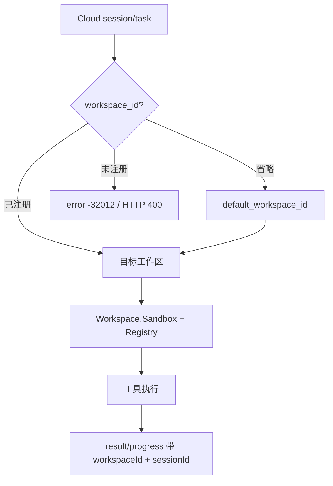

# 工作区与会话（Workspace / Session）

> **状态：V1 已实现（多工作区 + 会话路由）。**
>
> 一个端子可以同时注册多个本地工作区；每次工具调用携带 `workspaceId`（必选语义）和可选的 `sessionId`。云端可以在已注册的工作区之间**热切换**，不需要重启 daemon；不同工作区可以并发执行。
>
> 本文用 **`$LARES`** 表示端子的 app home：默认 `~/.lares`（Windows `%USERPROFILE%\.lares`），可用 `TERMIO_HOME` / `LARES_HOME` 覆盖。端子信息（config、log）在 `$LARES/.termio`。

## 1. 业务模型

```
用户设备（一个 daemon）
├── 工作区 A（例如 ~/projects/acme）
│   ├── 会话/任务 1  ── 工具调用都落在 A
│   ├── 会话/任务 2  ── 同样落在 A，与任务 1 共享目录
│   └── 会话/任务 3
├── 工作区 B（例如 ~/projects/blog）
│   └── 会话/任务 4
└── 工作区 C（可选）
```

关键关系：

- **一个工作区可以有多个会话/任务**，这是正常且常见的；会话不是目录副本，也不是安全边界。
- **一个会话/任务在同一时刻绑定一个工作区**。云端每次调用都应携带该任务对应的 `workspace_id`，工具只会在该工作区（及其额外根）内执行。
- **不同会话可以共享同一工作区**；它们看到同一份文件，可能并发读写（v1 工具只读）。
- **不同工作区可以同时工作**：工作区 A 的任务在跑搜索时，工作区 B 的任务可以同时执行；每个工作区有独立的沙箱、工具注册表和并发额度。
- **工作区只能由本地用户配置**；云端可以在“已注册的工作区”中选择，但不能新增、删除或把路径指向注册表之外。云端传的是不透明 ID，不是文件系统路径。

可以把工作区理解为：**用户本地授权给 Agent 的目录集合**。每次调用选择其中一个。工作区路径永远不会出现在注册信息或 API 响应中，只有 `id`/`name`。

## 2. 默认路径

| 系统 | `$LARES`（默认工作区） | 端子信息（永不开放） |
|---|---|---|
| Windows | `%USERPROFILE%\.lares` | `%USERPROFILE%\.lares\.termio` |
| macOS | `~/.lares` | `~/.lares/.termio` |
| Linux | `~/.lares` | `~/.lares/.termio` |

规则：

- `termio init` 未指定工作区时，注册一个默认工作区 `ws_default`，路径为 `$LARES`。
- `$LARES` 不存在时，`init` 创建它（Unix 0700；Windows 使用用户目录 ACL）。
- 显式 `--workspace PATH` 时，`PATH` **必须已存在且是目录**，避免拼写错误创建任意目录。
- `TERMIO_HOME` / `LARES_HOME` 只改变 `$LARES` 的位置，不改变工作区语义。
- 工作区路径会做绝对化和符号链接规范化（`EvalSymlinks`），再交给 `os.Root`。

## 3. 配置

新配置使用工作区数组和默认工作区 ID：

```json
{
  "workspaces": [
    {
      "id": "ws_default",
      "name": "default",
      "path": "C:\\Users\\alice\\.lares",
      "extra_roots": []
    },
    {
      "id": "ws_docs",
      "name": "docs",
      "path": "C:\\Users\\alice\\projects\\acme-docs",
      "extra_roots": ["C:\\Users\\alice\\shared"]
    }
  ],
  "default_workspace_id": "ws_default",
  "gateway_url": "wss://gateway.example.com/ws",
  "device_id": "dev_...",
  "device_name": "alice-laptop",
  "token": "...",
  "max_concurrent_calls": 4,
  "call_timeout_ms": 30000,
  "log_level": "info",
  "log_file": "C:\\Users\\alice\\.lares\\.termio\\termio.log"
}
```

字段：

| 字段 | 说明 |
|---|---|
| `workspaces[].id` | 云端可见的不透明 ID；1–128 个字母/数字/`.`/`-`/`_`；必须唯一 |
| `workspaces[].name` | 展示名，可省略；不参与路由 |
| `workspaces[].path` | 本地绝对路径，必须存在且是目录；不会上报云端 |
| `workspaces[].extra_roots` | 该工作区额外的允许根；仍属于同一个工作区上下文 |
| `default_workspace_id` | 调用省略 `workspaceId` 时使用的工作区；必须在列表中 |

校验：

- 至少有一个工作区；ID 唯一；路径唯一（规范化后不能有两个工作区指向同一目录）。
- 每个路径必须存在、是目录，并做符号链接规范化。
- 默认工作区必须存在。
- 工作区根不能落在 `$LARES/.termio` 或实际 config/log 路径内。

旧配置迁移（自动、无损）：

- 旧的单 `workspace` 变成 `workspaces[0]`，ID 为 `ws_default`，`name` 为 `default`。
- 旧的 `allowed_roots` 成为该工作区的 `extra_roots`。
- 只有 `allowed_roots`、没有 `workspace` 时，第一个 root 变成工作区，其余成为额外根。
- 保存后不再写 `workspace` / `allowed_roots` 旧字段。

## 4. 调用路由

云端 HTTP 调用：

```json
{
  "name": "search_files",
  "arguments": {"pattern": "*.go"},
  "workspace_id": "ws_docs",
  "session_id": "chat-42",
  "call_id": "stable-retry-id"
}
```

网关把它转成：

```json
{
  "jsonrpc": "2.0",
  "id": "g_...",
  "method": "tools/call",
  "params": {
    "name": "search_files",
    "arguments": {"pattern": "*.go"},
    "_meta": {
      "termio/callId": "stable-retry-id",
      "termio/workspaceId": "ws_docs",
      "termio/sessionId": "chat-42",
      "termio/timeoutMs": 30000
    }
  }
}
```

路由规则：

| 情况 | 行为 |
|---|---|
| `workspace_id` 省略 | 使用 `default_workspace_id`；网关在转发前填入默认 ID |
| `workspace_id` 是已注册 ID | 在该工作区的沙箱内执行 |
| `workspace_id` 不存在 | 网关按注册列表拒绝：JSON-RPC `-32012`，HTTP 400；旧地端未上报工作区时同样拒绝，避免静默落到唯一工作区 |
| `session_id` 省略 | 允许；调用仍落到工作区，只是无法按会话区分幂等缓存 |
| `session_id` 任意字符串 | 只是调用上下文标签，不是鉴权主体；长度 ≤ 256 可打印字符 |

结果、进度和取消通知都会带回 `termio/workspaceId` 和 `termio/sessionId`，方便云端关联任务。

daemon 不保存 `session → workspace` 的强绑定表；**每次调用以 `workspace_id` 为准**。绑定关系由云端会话状态维护：同一会话如果换了工作区，daemon 会把它当成新的工作区调用（幂等键也会不同），因此云端应保证同一任务不误传其他工作区 ID。

### 并发与切换

- **热切换**：只要两个工作区都已在配置中注册，云端就可以在连续调用中切换 `workspace_id`，无需重启 daemon。
- **并发**：每个工作区有独立的并发信号量（`max_concurrent_calls`）；工作区 A 慢不会占满工作区 B 的额度。
- **在途调用**：切换工作区不会影响已经开始的调用；每个调用在进入时固定自己的 `Workspace`，直到结束。
- **新增/删除工作区**：v1 需要重启 daemon，因为 daemon 启动时会为每个工作区打开 `os.Root`，网关也缓存了注册信息。重启会取消在途调用。
- **修改默认工作区**：需要重启 daemon 才对“省略 workspaceId”的调用生效。显式携带 `workspace_id` 的调用不受影响。

## 5. CLI

```bash
# 列出所有已注册工作区（* 表示默认）
termio workspace list

# 查看默认工作区，或指定 ID
termio workspace show
termio workspace show ws_docs

# 注册一个已存在的目录（默认自动生成 ws_ 开头的 ID）
termio workspace add ~/projects/acme-docs
termio workspace add --id ws_docs --name docs --root ~/shared ~/projects/acme-docs

# 删除注册（不删除磁盘文件；不能删除最后一个工作区）
termio workspace remove ws_docs

# 设置默认工作区（影响省略 workspaceId 的调用）
termio workspace default ws_default

# 兼容旧命令：选中已有目录并设为默认；不存在则注册
termio workspace set ~/projects/other

# 重置默认工作区为 ~/.lares
termio workspace reset
```

说明：

- `add` / `remove` / `default` / `reset` 写入配置后提示重启 daemon。
- `workspace set` 保留旧脚本语义：把目录设为默认；如果该目录尚未注册，会自动注册。
- `workspace list` 输出 ID、名称和本地路径；路径不会发给云端。
- 初始化时用 `--root` 为默认工作区添加额外根：

```bash
termio init --token <token> --workspace ~/.lares --root ~/shared
```

## 6. 工具行为

工作区决定工具的默认路径和沙箱根，不改变协议方法。

| 请求 | 行为 |
|---|---|
| `path` 省略 | 使用本次调用所选工作区的路径 |
| `path` 是相对路径 | 相对所选工作区解析，再做沙箱校验 |
| `path` 是绝对路径 | 必须位于所选工作区或其 `extra_roots` 内 |
| 绝对路径在有效根外 | 拒绝，`isError: true` / `path is outside the allowed roots` |
| 云端想通过参数改工作区 | 只能选择已注册的 `workspace_id`；不能提供文件系统路径 |

具体到工具：

- `search_files`：省略 `path` 时只搜索所选工作区；结果路径仍是绝对路径，可继续传给同一工作区的 `read_file`。
- `read_file`：相对路径相对所选工作区解析；绝对路径按所选工作区的有效根校验。
- `system_info`：返回本次调用实际使用的 `workspace` 和有效根；不同工作区会得到不同结果。
- 未来写工具：同样按 `workspace_id` 路由，并需要独立的审批/能力模型；v1 不提供。



## 7. 安全与信任边界

- **工作区选择是本地授权**：用户在本地注册目录，等价于把该目录的只读权限授予云端 Agent。云端不能替用户新增路径。
- **注册列表就是可调用范围**：云端可以在其中选择，但 `-32012` 阻止任何未注册 ID；传路径没有意义。
- **会话不是安全边界**：`session_id` 用于关联任务和幂等缓存，不用于鉴权；所有会话共享设备 token 的权限。不要用 `session_id` 表达租户信任差异。
- **`.termio` 是保留目录**：即使默认工作区就是 `$LARES`，工具也不能读写 `$LARES/.termio`。该目录对所有工作区生效；`search_files` 即使 `include_hidden: true` 也会跳过。自定义 config/log 位于任何工作区内时同样 deny。
- **失败关闭**：工作区被删除、移动、权限变化时，工具返回错误；不自动切到 home 或 `.lares`。
- **宽范围警告**：选择 home、`/` 或盘符根时 CLI 打印 warning；目前不强制拦截。
- **符号链接**：工作区路径做 `EvalSymlinks`；工具路径仍在 `os.Root` 内解析，阻止 symlink/junction 逃逸。
- **跨工作区隔离**：每个工作区有独立 `os.Root` 沙箱和工具注册表；A 的相对路径或绝对路径不会落到 B。
- **可移动/网络盘**：允许，断开时工具报错；不做自动回退。
- **多用户/多设备**：配置和工作区按 OS 用户隔离；每台设备各自维护工作区注册表，云端不统一设置。

## 8. 幂等、超时与取消

- 幂等键是 `(workspace_id, session_id, call_id)` 三元组；同一个 `call_id` 在工作区 A 和工作区 B 是两次独立调用。
- 同一工作区的不同会话使用同一个 `call_id` 也不会互相重放。
- 结果、progress、cancel 的 `_meta` 都包含工作区和会话，便于排查“结果落错工作区”。
- 超时和取消按调用独立生效；取消工作区 A 的调用不会影响工作区 B 或同工作区的其他会话。
- 重启 daemon 会清空内存幂等缓存。

## 9. 已知限制与后续

- v1 不支持运行中热加载配置：新增/删除工作区需要重启 daemon；工作区之间的切换不需要。
- 没有本地 UI；未来托盘/设置界面应通过本地控制面（Unix socket / Windows named pipe 或回环 + 本地鉴权）调用同一套 `config` 逻辑。
- `session_id` 不持久化；daemon 重启后会话关联只存在于云端。
- 没有按会话的并发配额；配额目前按工作区。
- 工作区数量上限 64（配置校验和网关注册都会检查），没有性能压测数据。

## 10. 验收标准

- [x] 配置支持多个工作区、默认工作区、每工作区额外根
- [x] 旧单工作区配置自动迁移，保存后只写新 schema
- [x] `workspace list/show/add/remove/default/set/reset` 可用
- [x] 调用按 `workspace_id` 路由；省略时用默认；未知 ID 返回 `-32012` / HTTP 400
- [x] 一个工作区可服务多个 `session_id`
- [x] 不同工作区可并发执行，互不占用并发额度
- [x] 相对路径和省略路径落在所选工作区
- [x] 同一工作区内的工具调用共享沙箱；跨工作区无法通过相对路径或绝对路径串目录
- [x] 幂等缓存按 `(workspace, session, callId)` 隔离
- [x] 结果/进度/取消回传工作区与会话
- [x] 工作区路径不出现在注册信息、`/v1/devices` 或 `/workspaces` 响应中
- [x] 新增/删除工作区提示重启；切换已注册工作区无需重启
- [ ] 热加载配置（下一版）
- [ ] 本地 UI 控制面（下一版）
